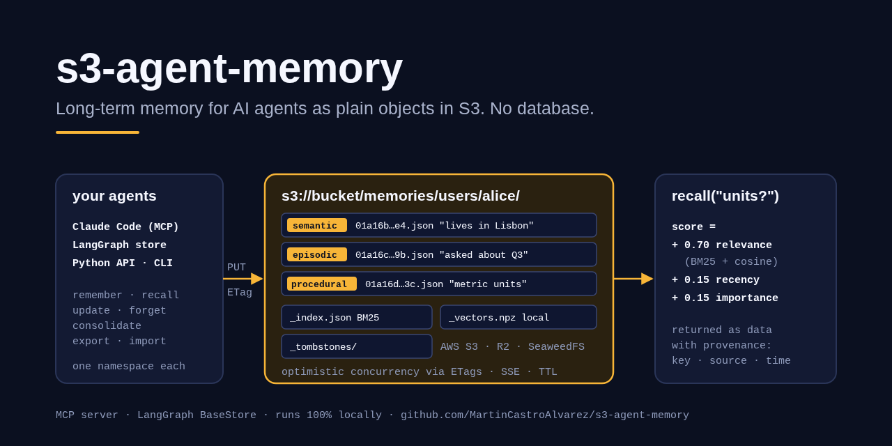
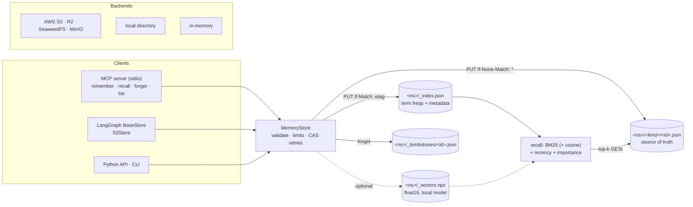

# s3-agent-memory

> Long-term memory for AI agents stored as plain JSON objects in any S3-compatible bucket: no database, no vector DB service. Keyword + optional local-embedding search, safe concurrent writes with S3 conditional requests, an MCP server and a LangGraph store.

[](https://github.com/MartinCastroAlvarez/s3-agent-memory/actions/workflows/ci.yml)
[](LICENSE)
[](pyproject.toml)
[](pyproject.toml)
[](https://modelcontextprotocol.io)



`s3-agent-memory` gives an agent typed memories (**semantic** facts,
**episodic** events, **procedural** instructions and preferences) that survive
across conversations. Each memory is one JSON object at
`<prefix>/<namespace>/<kind>/<id>.json`, next to a small per-namespace BM25
index and, optionally, a compact numpy shard of local embeddings. It works on
AWS S3, Cloudflare R2, SeaweedFS, MinIO, a local directory or an in-process
dict. Writes use S3 conditional requests (`If-None-Match: *`, `If-Match: <etag>`),
so many agents can write to the same namespace without losing updates.
Runs 100% locally, no paid APIs required.

## Why

Most agent-memory stacks need a database and a vector service before the
first fact is stored. For a few thousand memories per user that is a lot of
infrastructure: an S3 bucket already gives durability, versioning, encryption,
lifecycle rules, IAM and a price close to zero. What it lacks is search and
safe concurrent updates, and that is what this library adds:

- **Search without a service.** A per-namespace index (term frequencies and
  ranking metadata, never the text) makes `recall` one GET plus the top-k
  objects. BM25 is pure Python; embeddings are an opt-in extra that runs a local
  open-source model (fastembed / sentence-transformers).
- **Concurrency without locks.** Every shared object is changed with
  compare-and-swap on its ETag, so a lost race is retried, not lost. Tested with
  threads against moto, the filesystem backend and a real SeaweedFS server in CI.
- **Isolation by construction.** Namespaces and ids go through a strict
  allow-list; the MCP server is bound to one namespace and has no namespace
  argument; an object found under the wrong key is refused.
- **Plain files.** Memories are readable JSON. Export/import is JSONL, and
  the index can always be rebuilt from the objects.

## Quickstart

```bash
pip install "s3-agent-memory[s3] @ git+https://github.com/MartinCastroAlvarez/s3-agent-memory"
s3-agent-memory remember "Alice prefers metric units" --kind procedural -n users/alice
s3-agent-memory recall "which units?" -n users/alice          # -> JSON with score + provenance
claude mcp add memory -- s3-agent-memory serve -n users/alice  # MCP for Claude Code
docker compose up -d && python examples/s3_demo.py             # same thing on local S3
```

Without `--url` the CLI stores memories in `./.agent-memory/` (filesystem
backend). It will be `pip install "s3-agent-memory[s3]"` once the first release
is on PyPI.

```python
from s3_agent_memory import MemoryStore

store = MemoryStore.from_url("s3://my-bucket/agents")   # or file://./mem, memory://
store.remember("users/alice", "Alice is vegetarian", tags=["food"], importance=0.8)
store.remember("users/alice", "Asked for a ramen recipe", kind="episodic", ttl=7 * 86400)
for hit in store.recall("users/alice", "what can Alice eat?"):
    print(hit.score, hit.memory.content, hit.key)
```

## How it works



1. **remember** reserves the id in the index (compare-and-swap), then creates
   the memory object with `If-None-Match: *`, then (if an embedder is set)
   adds its vector to the shard, again with compare-and-swap. Ids are unique per
   namespace across kinds.
2. **recall** reads the index, scores every eligible memory (not expired, kind
   and tag filters) and fetches only the winners:
   `score = 0.7 * relevance + 0.15 * recency + 0.15 * importance`, where
   relevance is BM25 normalised to the best hit (mixed 50/50 with cosine
   similarity when embeddings exist), recency is `0.5 ** (age / half_life)`
   with half-lives of 30 days for episodic, 180 for semantic and none for
   procedural memories, and importance is the 0-1 prior you gave. An empty query
   ranks by recency and importance. Weights live in `Ranking`.
3. **update** writes with `If-Match` on the memory's ETag and bumps its
   `version`. Pass `expected_version=` for strict optimistic concurrency (a
   concurrent change raises `ConflictError`); without it a lost race re-reads
   and re-applies the change.
4. **forget** writes a tombstone (id, kind, time, reason; no content),
   hard-deletes the object, and removes it from the index and shard.
   `prune_expired` forgets memories past their TTL.
5. **consolidate** groups near-duplicates per kind (token Jaccard, plus cosine
   when embeddings exist), merges each group with a summariser (a local ollama
   model by default, `LongestSummariser` with no model), records
   `consolidated_from`, and forgets the originals.
6. **export / import** move memories as JSONL. Import writes only into the
   target namespace (the namespace in the file is ignored), skips existing ids
   unless `overwrite=True`, and never resurrects a forgotten id unless
   `resurrect=True`.
7. **reindex** rebuilds the index and shard from the objects, so the index is
   a cache you can delete.

### Object layout

```text
s3://bucket/<prefix>/users/alice/semantic/01a16b209bf83fe5ba69f185.json
s3://bucket/<prefix>/users/alice/episodic/01a16b20a1c2d3e4f5a6b7c8.json
s3://bucket/<prefix>/users/alice/procedural/01a16b209bf8ad13a72e486e.json
s3://bucket/<prefix>/users/alice/_index.json
s3://bucket/<prefix>/users/alice/_vectors.npz          # only with an embedder
s3://bucket/<prefix>/users/alice/_tombstones/<id>.json
```

```json
{"schema":1,"id":"01a16b209bf8ad13a72e486e","namespace":["users","alice"],"kind":"procedural",
 "content":"Alice prefers metric units","source":"chat:42","importance":0.9,"tags":["prefs"],
 "created_at":"2026-10-23T23:37:41.624370Z","updated_at":"2026-10-23T23:37:41.624370Z",
 "expires_at":null,"data":null,"metadata":{},"version":1}
```

Ids are time-ordered (`<ms hex><random hex>`), so a plain listing is
chronological.

## MCP server

`s3-agent-memory serve -n <namespace>` starts an MCP server on stdio (official
`mcp` SDK 2.x, `MCPServer`). The namespace is fixed at startup: no tool takes a
namespace, so one user's agent cannot reach another user's memories.

| Tool | Does |
| --- | --- |
| `remember(content, kind?, tags?, importance?, ttl_days?, source?)` | store one memory, returns its id and key |
| `recall(query, kind?, tags?, limit?)` | hybrid search; results come in an envelope with `untrusted_content: true` and per-memory provenance |
| `list(kind?, tag?, limit?)` | most recently updated memories |
| `forget(id)` | hard delete + tombstone (annotated destructive) |

`--read-only` keeps `recall` and `list` usable and refuses writes. Client
snippets are in [`examples/`](examples/): Claude Code
(`claude mcp add memory -- s3-agent-memory serve -n users/me`), Cursor, and any
client that launches a stdio command.

## LangGraph store

```python
from s3_agent_memory import MemoryStore
from s3_agent_memory.langgraph_store import S3Store

store = S3Store(MemoryStore.from_url("s3://my-bucket/agents"), index=["text"])
graph = builder.compile(store=store)          # nodes receive `store: BaseStore`
store.put(("users", "alice", "prefs"), "units", {"text": "metric"})
store.search(("users", "alice"), query="units", filter={"text": "metric"})
```

`S3Store` implements `batch`/`abatch` for LangGraph's `GetOp`, `PutOp`,
`SearchOp` and `ListNamespacesOp` (`pip install "s3-agent-memory[langgraph]"`).
Values are stored in the memory's `data`; the text of the `index` fields (or
every string in the value) is what gets searched. Filters support equality and
`$eq $ne $gt $gte $lt $lte`. TTLs are in minutes with `refresh_on_read`, as in
LangGraph. Keys that are not safe ids are stored under a SHA-256-derived id.
See [`examples/langgraph_agent.py`](examples/langgraph_agent.py).

## CLI

```text
s3-agent-memory remember TEXT [--kind K] [--tag T]... [--importance F] [--ttl-days N] [--source S] [--id ID]
s3-agent-memory recall QUERY [--kind K] [--tag T]... [--limit N]
s3-agent-memory get ID | forget ID [--reason R] | update ID [--content C] [--importance F] [--tag T]... [--expected-version V]
s3-agent-memory list [--kind K] [--tag T]... [--limit N]
s3-agent-memory consolidate [--kind K] [--threshold F] [--summariser ollama|longest] [--model M] [--dry-run]
s3-agent-memory prune | reindex | stats | namespaces [PREFIX]
s3-agent-memory export [-o FILE] [--include-expired] | import FILE [--overwrite] [--resurrect]
s3-agent-memory serve [--read-only]
# every command: [--url URL] [-n NAMESPACE] [--embeddings none|fastembed|sentence-transformers] [--embedding-model M]
```

Output is JSON. Exit codes: `0` ok, `1` not found, `2` validation error, `3`
conflict or backend error.

## Configuration

| Setting | Env | Default | Meaning |
| --- | --- | --- | --- |
| store URL | `S3_AGENT_MEMORY_URL` | `file://./.agent-memory` | `s3://bucket/prefix`, `file://DIR`, `memory://` |
| namespace | `S3_AGENT_MEMORY_NAMESPACE` | `default` | `users/alice`, `agents/support/ticket-7` (1-8 segments) |
| S3 endpoint | `S3_AGENT_MEMORY_ENDPOINT_URL` (or boto3's `AWS_ENDPOINT_URL_S3`) | AWS | SeaweedFS `http://localhost:8333`, MinIO `:9000`, R2 `https://<acct>.r2.cloudflarestorage.com` |
| region | `S3_AGENT_MEMORY_REGION` | boto3 default | |
| server-side encryption | `S3_AGENT_MEMORY_SSE` | none (bucket default) | `AES256`, `aws:kms`, `aws:kms:dsse` |
| KMS key | `S3_AGENT_MEMORY_KMS_KEY_ID` | | with `aws:kms*` |
| embeddings | `S3_AGENT_MEMORY_EMBEDDINGS` | `none` | `fastembed` (`[fastembed]` extra) or `sentence-transformers` |
| embedding model | `S3_AGENT_MEMORY_EMBEDDING_MODEL` | `BAAI/bge-small-en-v1.5` / `all-MiniLM-L6-v2` | any local model of that library |
| consolidation model | `S3_AGENT_MEMORY_OLLAMA_MODEL`, `OLLAMA_HOST` | `llama3.2`, `http://localhost:11434` | local ollama |
| credentials | boto3 chain (`AWS_PROFILE`, env, instance role) | | never read, stored or logged by this package |

Limits (`Limits(...)` on `MemoryStore`): content 16 KiB, data 32 KiB,
metadata 4 KiB, 32 tags, 1 MiB per memory object read, 64 MiB per index or
shard read, 100 000 memories per namespace, 2 000-character queries, 100
results, 128 KiB per JSONL line.

Extras: `[s3]` boto3, `[embeddings]` numpy (bring your own embedder: any object
with `name` and `embed(texts)`), `[fastembed]` numpy + fastembed, `[langgraph]`.
The core needs only the `mcp` SDK.

**Server-side encryption.** On AWS, prefer bucket default encryption (SSE-S3 or
SSE-KMS with a bucket key) and Block Public Access; `S3_AGENT_MEMORY_SSE` sets
the header per object when the bucket policy requires it. Turn on bucket
versioning if you want undo for `forget` beyond the tombstone; add a lifecycle
rule on noncurrent versions so deleted memories really go away.

## Local S3

```bash
docker compose up -d            # SeaweedFS S3 API on 127.0.0.1:8333, bucket agent-memory
cp .env.example .env && set -a && . ./.env && set +a
python examples/s3_demo.py      # typed memories, 8 concurrent writers, a refused stale update
```

MinIO works too (`docker compose --profile minio up -d` with `MINIO_IMAGE` set):
upstream stopped publishing community images in October 2025, so SeaweedFS is
the default. Both support the conditional writes this library relies on.

## Security

Memory content is untrusted input that ends up in a model's context. Recall
returns it as a JSON field with provenance (object key, source, timestamps,
version), the MCP envelope says it is data not instructions, and the server
instructions tell the model not to follow requests found inside memories. Keys
are allow-listed (no `..`, `/`, `\`, `%`, NUL, reserved names), the filesystem
backend refuses symlinks and paths outside its root, every read is
size-bounded, vector shards load with `allow_pickle=False` after a zip-bomb
check, tampered objects are refused, and no log line contains memory text or
credentials. Threat model and reporting: [`SECURITY.md`](SECURITY.md).

## Testing

```bash
python -m venv .venv && . .venv/bin/activate && pip install poetry && poetry install -E s3 -E embeddings -E langgraph
poetry run pytest                                   # 240 tests, coverage ~97%
poetry run ruff check s3_agent_memory tests examples && poetry run mypy s3_agent_memory
S3_AGENT_MEMORY_LIVE_ENDPOINT=http://127.0.0.1:8333 poetry run pytest -k s3-live --no-cov   # real local S3
```

Every backend test runs on the in-memory, filesystem and S3 (moto `mock_aws`)
backends, and on a real SeaweedFS server in CI. Concurrency tests start
threads behind a barrier (remember, update, strict `expected_version`), inject
a writer between read and conditional write to prove the 412 is retried, and
check give-up after `max_retries`. Security tests cover path traversal and key
injection, symlinks, tampered index/memory/shard objects, size limits,
namespace isolation through every interface, and that logs carry no content or
credentials. The consolidation summariser is tested against a fake local ollama
HTTP server. Nothing calls AWS or a hosted model.

## Part of the series

| Series | Repositories |
| --- | --- |
| Agent tooling | [agent-lint](https://github.com/MartinCastroAlvarez/agent-lint) · [repo-graph-mcp](https://github.com/MartinCastroAlvarez/repo-graph-mcp) · **s3-agent-memory** · [pytest-llm-evals](https://github.com/MartinCastroAlvarez/pytest-llm-evals) · [serverless-mcp-aws](https://github.com/MartinCastroAlvarez/serverless-mcp-aws) · [agent-model-router](https://github.com/MartinCastroAlvarez/agent-model-router) |
| Django admin family | [django-admin-react](https://github.com/MartinCastroAlvarez/django-admin-react) · [django-admin-rest-api](https://github.com/MartinCastroAlvarez/django-admin-rest-api) · [django-admin-mcp-api](https://github.com/MartinCastroAlvarez/django-admin-mcp-api) · [django-admin-graph](https://github.com/MartinCastroAlvarez/django-admin-graph) · [django-admin-skills](https://github.com/MartinCastroAlvarez/django-admin-skills) |
| Apps | [local-rag-ollama](https://github.com/MartinCastroAlvarez/local-rag-ollama) · [ui-review-agent](https://github.com/MartinCastroAlvarez/ui-review-agent) |
| Memory patterns | [langgraph-short-long-term-memory](https://github.com/MartinCastroAlvarez/langgraph-short-long-term-memory) · [adk-vertex-memory-bank](https://github.com/MartinCastroAlvarez/adk-vertex-memory-bank) |
| Patterns catalog | [agentic-architectures](https://github.com/MartinCastroAlvarez/agentic-architectures) — every agent pattern, linking the LangGraph, ADK, CrewAI and LangChain repos |

## Contributing

See [`CONTRIBUTING.md`](CONTRIBUTING.md), [`ARCHITECTURE.md`](ARCHITECTURE.md),
[`SECURITY.md`](SECURITY.md) and the agent contract in [`CLAUDE.md`](CLAUDE.md).

## License

MIT © 2026 Martín Castro Álvarez. See [LICENSE](LICENSE).
